I'm a Computer Engineering student at the **University of Granada**. I like the layer of computing most people never see: running **Linux servers**, tinkering with operating systems, checking and fixing hardware, and **building all kinds of projects** to see how far they go.

I have spent two summers in **London** as a **DevOps** intern at White Swan Data. In 2024 I built a **React Native app** for one department's internal system. In 2025 I went back to build **AI agents**: APIs for them and a system of collaborating agents that browse web pages and enter data on their own.

**Right now** I'm finishing my degree while building useful software and infrastructure with people who want the same thing: making things that help real people and businesses.

---

#### Things I've built for the real world

**[NetTune](https://github.com/5d0tal1gat0r/NetTune)** · a shopping centre's security team uses it every day. Handwritten log sheets are scanned on a Raspberry Pi, read twice by a vision model, checked by a person, and turned into the monthly Word report. About €1.20 a month.
`Python` `OpenAI Vision` `Raspberry Pi` `SQLite`

**[bocatto](https://www.bocatto.app)** · a tapas review app for iOS and Android, with a monthly ranking that puts the best dishes on a podium. 2nd place at Startup Weekend Granada 2026.
`React Native` `Expo` `TypeScript` `React Query`

**[Stackline](https://jesusrgc.dev/en/projects/stackline/)** · five university lab practices, one web farm: eight Apache containers behind HAProxy, Nginx and Traefik, my own certificate authority, and deny-by-default firewalls.
`Docker` `HAProxy` `Nginx` `OpenSSL` `iptables` `Locust`

**[omarchy-plugins](https://github.com/5d0tal1gat0r/omarchy-stocks)** · a stock ticker and an [AI agent watcher](https://github.com/5d0tal1gat0r/omarchy-agent-watcher) for the Omarchy desktop bar.
`QML` `Quickshell` `Hyprland`

---

<picture></picture>
<picture></picture>

[**jesusrgc.dev**](https://jesusrgc.dev) &nbsp;·&nbsp; [LinkedIn](https://www.linkedin.com/in/jes%C3%BAs-rgc) &nbsp;·&nbsp; [contacto@jesusrgc.dev](mailto:contacto@jesusrgc.dev)
